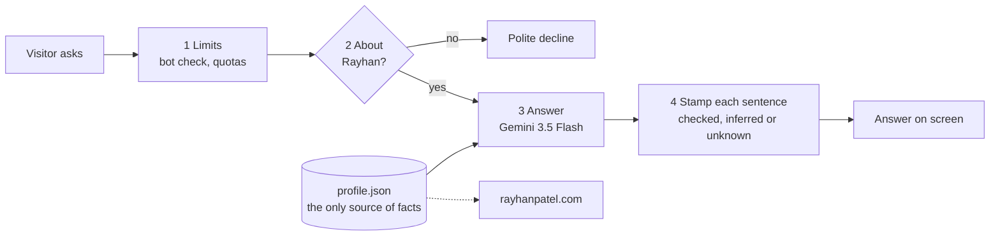

# AI Resume Agent

The agent behind [chat.rayhanpatel.com](https://chat.rayhanpatel.com). It answers recruiters' and engineers' questions about Rayhan Patel, using only his public profile, and marks every sentence it says as checked against that profile, inferred, or unknown.

[](https://chat.rayhanpatel.com)
[](https://rayhan-ai-resume-production-6239.up.railway.app/api/v1/health)
[](https://github.com/Rayhanpatel/AI-Resume-Agent/actions)
[](LICENSE)

<p align="center">
  
</p>
<p align="center"><sub>Recorded February 2026; the live chat now also shows a stamp under every sentence. <a href="https://youtu.be/5xGjCrDEoMQ">Architecture walkthrough (video)</a></sub></p>

## How it works



1. **Limits.** A bot check and signed sessions, plus per-visitor and daily token limits, under a monthly spend cap.
2. **About Rayhan?** A small decision model (TypeSafe's Jev) decides in about 0.2 s whether the message is about him, using the previous turn too. Unrelated requests get a polite decline.
3. **Answer.** Gemini answers from one file, `profile.json`, the same file that renders [rayhanpatel.com](https://rayhanpatel.com), so the site and the agent can't disagree. If the model fails, a second one takes over.
4. **Stamp.** A fast model proposes a quote from the profile for each sentence. Code then confirms the quote is really there and checks every number. Words stream first, and the stamps follow.

Other agents can use the same agent over MCP at `/mcp`, with the tools `get_profile`, `ask` and `fit_report`.

## Measured

| | Result |
|---|---|
| Sentences backed by a verbatim profile quote | 96% on the 20-question golden set (Oct 31, 2026) |
| Real questions the off-topic check wrongly refused | 0 of 33 on held-out conversations (7 before the fix) |
| Attacks it gave in to (rumors, fake overrides, roasts…) | 1 of 40 held-out replies (15 before the fix) |
| First words on screen | 2.5 s median (Oct 30, 2026) |
| Cost per answer | about 1 cent |

The off-topic and attack numbers come from held-out sets that were committed before the change they judged and written by a different model. Every run is in [`backend/evals/results/`](backend/evals/results/). [Full eval report →](docs/EVAL-REPORT.md)

## Run like a production service

- **Monitored from outside:** 9 Grafana synthetic checks, including a real browser every 15 minutes. A broken chat pages the owner's phone, and every alert has a [runbook](docs/runbooks/).
- **Gated:** over 100 unit tests and the golden eval against the live model must pass before a backend deploy.
- **Honest about failure:** a [post-mortem](docs/POSTMORTEM-2026-10-chatbot-outage.md) of four months of silent outage, and of what broke while fixing it.

## Read more

| If you want… | Read |
|---|---|
| The design, with C4 and UML diagrams | [docs/ARCHITECTURE.md](docs/ARCHITECTURE.md) |
| How it holds up to attacks | [Threats and defences](docs/ARCHITECTURE.md#12-threats-and-defences), [eval report §6](docs/EVAL-REPORT.md#6-what-does-it-say-to-attacks-oct-3031-2026) |
| Every number, with method and dates | [docs/EVAL-REPORT.md](docs/EVAL-REPORT.md) |
| What data it touches, safety controls, known failures | [docs/SYSTEM-CARD.md](docs/SYSTEM-CARD.md) |
| What broke and what changed | [docs/POSTMORTEM-2026-10-chatbot-outage.md](docs/POSTMORTEM-2026-10-chatbot-outage.md) |
| Monitoring and alerts | [docs/MONITORING.md](docs/MONITORING.md), [monitoring/](monitoring/README.md), [runbooks](docs/runbooks/) |
| API, configuration, file layout, features, stack | [docs/REFERENCE.md](docs/REFERENCE.md) |

## Run it locally

```bash
git clone https://github.com/Rayhanpatel/AI-Resume-Agent.git && cd AI-Resume-Agent
make setup
cp backend/.env.example backend/.env    # add GOOGLE_API_KEY; everything else is optional
make api    # backend on :8000
make ui     # frontend on :5173, in a second terminal
```

Only `GOOGLE_API_KEY` is required; each other service switches off cleanly without its key ([all variables](docs/REFERENCE.md#configuration-reference)).

## Author

**Rayhan Patel** — MS Applied Machine Learning @ University of Maryland

[](https://rayhanpatel.com)
[](https://linkedin.com/in/rayhan-patel-cs)
[](mailto:rayhanbp@umd.edu)

---

## License

MIT — see [LICENSE](LICENSE) for details.
