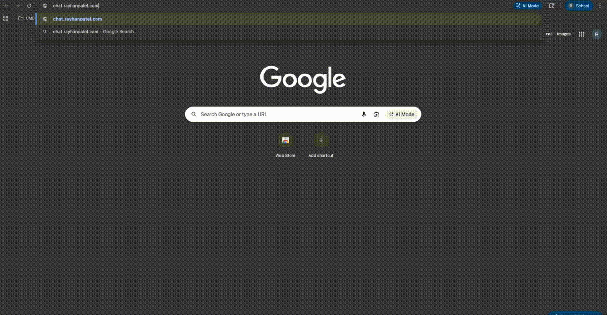
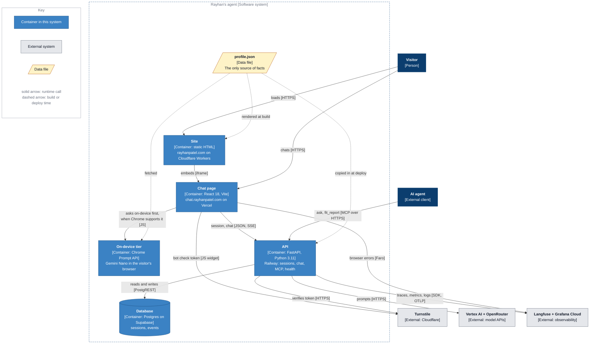
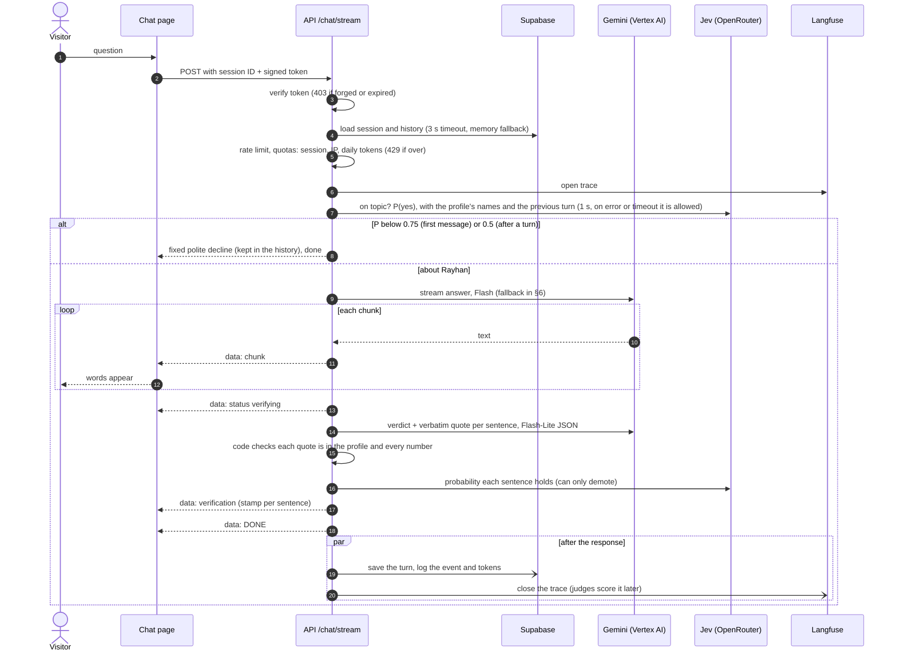

# AI Resume Chatbot

A conversational AI agent that answers recruiter questions about Rayhan Patel's professional background — built with observability, security, and graceful degradation in mind. FastAPI, Gemini 3.5 Flash on Vertex AI with automatic model fallback, and React 18. Raw HTTP calls to Gemini (no SDK), server-side sessions with real multi-turn history, SSE streaming, LLM-as-a-Judge evaluation, and a golden-question eval that runs against the real model.

Its knowledge comes from `backend/core/profile.json`, the same public profile that renders [rayhanpatel.com](https://rayhanpatel.com), so the site and the agent can't drift apart.

[](https://chat.rayhanpatel.com)
[](https://rayhan-ai-resume-production-6239.up.railway.app/api/v1/health)
[](https://github.com/Rayhanpatel/AI-Resume-Agent/actions)
[](LICENSE)

---

## Demo

<p align="center">
  
</p>

<p align="center"><sub>Recorded February 2026. The live chat now adds a verification stamp to every sentence; try it at <a href="https://chat.rayhanpatel.com">chat.rayhanpatel.com</a>.</sub></p>

> 🎬 **[Watch the full architecture walkthrough](https://youtu.be/5xGjCrDEoMQ)** · **[Try it live →](https://chat.rayhanpatel.com)**

---

## Operations

It runs in production with one person on call, so the work after shipping is in the repo too:

- **Checks from outside, on a schedule:** 9 Grafana Synthetic Monitoring checks (the chat page in a real browser every 15 minutes, model and database health every 5 minutes from two locations, the site and resume, DNS, domain and certificate expiry) plus a real answer, verified sentence by sentence, every 6 hours.
- **Telemetry:** OpenTelemetry traces, metrics and logs to Grafana Cloud with a `gen_ai` span around every model call and no message text; Grafana Faro for browser errors; Langfuse for answer quality with five LLM judges.
- **Alerts:** a broken chat or site pages the owner's phone through Grafana IRM; slower problems (fallback model, unverifiable answers, an off-topic gate refusing too much or declining a mid-conversation message, decision-model drift, failed leads, retention, spend) go to email. Every alert links a [runbook](docs/runbooks/). A test alert on Oct 30, 2026 went from a Grafana rule to the phone in 32 seconds (IRM delivery log).
- **Gates:** over 100 unit tests (including checks that these docs match the code) and a 20-question golden eval against the live model, four of its questions attacks, run before a backend deploy (Railway waits for CI); a weekly check fails when a configured model nears retirement.
- **Attack-tested:** 55 attack messages in five types (fake overrides, prompt and key requests, false claims, made-up rumours, roasts), answered with the off-topic gate bypassed and judged by a model from another family. On held-out attacks written by another model, the bot gave in on 15 of 40 replies before 2.11.0 and 1 of 40 after ([eval report §6](docs/EVAL-REPORT.md#6-what-does-it-say-to-attacks-oct-3031-2026), [threats and defences](docs/ARCHITECTURE.md#12-threats-and-defences)).
- **Limits and data:** signed sessions, per-IP and per-session quotas, a daily token budget, a $25/month Google Cloud spend cap; visitor chats are deleted after 90 days.
- **Written down:** [post-mortem](docs/POSTMORTEM-2026-10-chatbot-outage.md) (four months of silent outage, and what broke while fixing it), [system card](docs/SYSTEM-CARD.md), [eval report](docs/EVAL-REPORT.md), [monitoring design](docs/MONITORING.md).

---

## Quick Start

### Prerequisites

- Python 3.11+
- Node.js 18+

### Setup

```bash
git clone https://github.com/Rayhanpatel/AI-Resume-Agent.git
cd AI-Resume-Agent
make setup
```

### Configure

Copy the example env file and fill in your API keys:

```bash
# Backend (required — only GOOGLE_API_KEY is needed to run)
cp backend/.env.example backend/.env
# Edit backend/.env and add your GOOGLE_API_KEY

# Frontend (optional — defaults to localhost:8000)
cp frontend/.env.example frontend/.env
```

See [Configuration Reference](#configuration-reference) for all variables.

### Run

```bash
# Terminal 1 — Backend (FastAPI on :8000)
make api

# Terminal 2 — Frontend (Vite on :5173)
make ui
```

The frontend proxies `/api` requests to the backend during development (configured in `vite.config.js`).

---

## Features

| Feature | Description | Implementation |
|---------|-------------|----------------|
| Real-time Streaming | Token-by-token response delivery | SSE with `X-Accel-Buffering: no` to bypass Cloudflare/nginx buffering |
| Verification Stamps | Every sentence is marked checked / inferred / unknown, with the profile quote | A fast-model JSON pass proposes verdicts and verbatim quotes; code confirms each quote and checks every number against the profile (`verifier.py`); streamed after the answer, shown in a panel |
| MCP Interface | Other agents can call the same agent | `/mcp` (protocol 2026-07-28, stateless): read-only `get_profile`, `ask` (with stamps), `fit_report` (`mcp_server.py`) |
| Model Fallback | A slow or failing model never takes the chat down | Answer model → fallback model if it errors, returns nothing, or stays silent past `GEMINI_FIRST_TOKEN_TIMEOUT`; the fallback gets one patient retry (`agent.py`) |
| Models as Config | Google retires model IDs; changing one is an env var | `GEMINI_MODEL`, `GEMINI_FALLBACK_MODEL`, `GEMINI_FAST_MODEL` in `config.py`; one request helper in `services/gemini.py` |
| Real Health Check | Catches a dead model, not just a dead process | `/api/v1/health/llm` makes a real model call (cached 10 min, failures retried after 60 s) and returns 503 when it fails |
| Conversation History | Follow-up questions work | The last 10 messages live in the server-side session (a client can't rewrite them); declined turns are kept too, so the gate judges the next message against them |
| Golden Eval | Checks what the model actually says | `backend/evals/golden.py`: 20 questions (recruiter questions, multi-turn pressure, four attacks) with must-say / must-not-say checks, run against the real model on every backend push |
| Attack Handling | Rumours, false premises, fake overrides, prompt requests and roasts get safe answers | Rules per attack type in the prompt; nothing secret in the model's context; measured by `backend/evals/attack_bench.py` with a holdout written by another model (`docs/EVAL-REPORT.md` §6) |
| Truth Tests | Known-wrong claims can't come back | `tests/test_profile.py` fails CI if banned wording appears in the profile or the rendered prompt |
| Vertex / AI Studio | Vertex AI in production, AI Studio for local runs | Chosen in `vertex_auth.py` from credential availability |
| Job URL Extraction | Paste LinkedIn/Greenhouse/Lever URLs | SSRF-protected fetcher in `job_extractor.py`: literal-IP blocklist, hostname resolution checked against private ranges, no redirects, size and type limits |
| LLM-Powered Job Parsing | Structured extraction from job postings | Gemini Flash with `responseMimeType: application/json` in `job_parser.py` |
| Dynamic Starter Prompts | Context-aware suggested questions | LLM-generated per job description with generic fallback defaults in `prompt_generator.py` |
| Server-side Sessions | A client can't forge who it is or what was said | `/session` issues a signed token after Turnstile; `/chat` requires it; name, company, job schema and the last 10 turns live in the session row (`session_tokens.py`, `chat.py`) |
| Quotas That Survive Restarts | Cost abuse is bounded | Messages per session, messages and sessions per IP per day (salted IP hashes), and a global daily token budget, all counted from the events table (`quotas.py`) |
| Origin Lock | Direct hits on the Railway URL are refused | `X-Origin-Secret` added by Cloudflare once the API is proxied; health stays open (`core/origin.py`) |
| Off-topic Gate | Declines unrelated requests and plain jailbreaks before the answer model runs (a topic filter, not a security control: attacks about Rayhan pass to the answer layer) | TypeSafe's decision model (`jev-1.14`, through OpenRouter) returns P(on topic) for one fixed question, with the profile's names as context; after the first message it also sees the previous turn, so short follow-ups count; thresholds 0.75 and 0.5 chosen on labelled sets; if it fails or takes over 1 s the message goes to the answer model, which declines off-topic requests itself (`intent.py`; [benchmarks](docs/EVAL-REPORT.md#5-should-it-answer-at-all-the-off-topic-gate-oct-30-2026)) |
| Prompt Injection Defense | A job page never reaches the persona model as text | A separate tool-less call extracts a fixed schema (title, level, skills, location, summary); only the bounded schema is rendered into the prompt (`render_job_context` in `prompts.py`) |
| Observability | Full LLM tracing, cost tracking, and automated quality evaluation | Langfuse Python SDK 5 (Langfuse v4 data model: one root observation per turn, generations as children, session and user propagated) with per-model pricing in `tracer.py` + 5 LLM-as-a-Judge evaluators (Hallucination, Relevance, Conciseness, Helpfulness, Toxicity) |
| Rate Limiting | Per-IP sliding window throttle | Keys on `X-Real-IP`, which Railway's edge overwrites; caller-sent `CF-Connecting-IP` and `X-Forwarded-For` are ignored (`middleware/rate_limiter.py`) |
| Session Persistence | Backend: Supabase PostgreSQL, Frontend: localStorage | 24h TTL, in-memory `TTLCache` fallback if DB is down; the AI disclosure is in the first message |
| Session Resume | "Welcome back" modal for returning users | `localStorage` check on mount in `useChatSession.js` |
| Dark/Light Theme | Full theme toggle with OS preference detection | `ThemeToggle.jsx` + 150 lines of CSS overrides in `index.css` |
| Share Conversation | Copy full chat transcript to clipboard | `shareChat()` in `ChatInterface.jsx` with attribution link |
| Keyboard Shortcuts | `Cmd+K` focus input, `Escape` reset chat | Event listeners in `ChatInterface.jsx` + `useChatSession.js` |
| Lead Capture | Recruiter data sent to Google Sheets | Webhook in `leads.py`; the sheet's reply is checked and each outcome counted (`chat.leads`), so a refused lead raises an alert |
| Data Retention | Visitor chats deleted after 90 days idle | Daily job in `main.py` (`maintain_data`): Supabase rows and Langfuse traces |
| Accessibility | WCAG-compliant | `aria-live="polite"`, `role="dialog"`, `aria-modal`, `prefers-reduced-motion` |
| Error Recovery | Graceful crash handling | React `ErrorBoundary` (class component) with dev-only stack traces |
| SEO | Social sharing optimization | Open Graph + Twitter Card meta tags in `index.html` |
| Mobile Polish | iOS-specific fixes | `font-size: 16px` (prevents auto-zoom), `overscroll-behavior-y: none` |
| Graceful Degradation | Every external service fails silently | Each service has an `enabled` flag; if Supabase/Langfuse is down, chat continues in ephemeral mode |
| Bot Protection | Smart CAPTCHA that challenges bots but passes humans | Cloudflare Turnstile (Managed Mode) in `WelcomeForm.jsx` + server-side validation in `session.py` (Fails open if Cloudflare is down) |
| Visitor Analytics | Privacy-friendly page view & visitor tracking | Vercel Analytics (`@vercel/analytics/react`) in `main.jsx`; automated browsers (the monitoring check) are excluded |
| Observability | Traces, metrics and logs; browser errors | OpenTelemetry → Grafana Cloud (`core/telemetry.py`); Grafana Faro on chat.rayhanpatel.com (`src/lib/telemetry.js`) |
| Uptime and Alerts | Outside checks and on-call alerts | 9 Grafana Synthetic Monitoring checks plus a real-answer check every 6 hours; alerts to email and phone (Grafana IRM); see `monitoring/README.md` |
| Performance Monitoring | Real User Metrics (Core Web Vitals) | Vercel Speed Insights (`@vercel/speed-insights/react`) in `main.jsx` |
| Input Sanitization | HTML stripped from all user input before validation | `_strip_html()` regex runs via `@field_validator(mode="before")` across all Pydantic models |

---

## Architecture

Three containers you can reach (the site, the chat page, the API), one data file every fact comes from, and a model that may run in the visitor's own browser. Thin FastAPI routes delegate to services; every external dependency has an `enabled` flag, so the chat degrades instead of failing. The full design, with eleven views (C4 context, containers and components; UML sequence, state and entity-relationship diagrams; deployment; monitoring; decisions), is in **[docs/ARCHITECTURE.md](docs/ARCHITECTURE.md)**.

### Containers



### How a question is answered

Words stream first; the verification stamps follow in the same stream, so the visitor never waits for them.



### More views in [docs/ARCHITECTURE.md](docs/ARCHITECTURE.md)

| View | Shows |
|---|---|
| [System context](docs/ARCHITECTURE.md#1-system-context) | Who uses it and every external service it depends on |
| [Backend components](docs/ARCHITECTURE.md#3-backend-components) | Middleware, routes, guards, services, adapters, and which route uses what |
| [Starting a chat](docs/ARCHITECTURE.md#4-starting-a-chat) | Turnstile, job-post extraction (schema only), the signed session token |
| [Model fallback](docs/ARCHITECTURE.md#6-model-fallback-state-machine) | Flash → Flash-Lite → last try → apology, with the timeouts |
| [Stamping a sentence](docs/ARCHITECTURE.md#7-how-a-sentence-gets-its-stamp) | How code, not the model, decides `checked` |
| [MCP and on-device](docs/ARCHITECTURE.md#8-agents-over-mcp-and-the-on-device-tier) | The two other ways in, and the cloud fallback |
| [Data](docs/ARCHITECTURE.md#9-data-model-and-where-data-goes) | The two tables, and where visitor data can go and for how long |
| [Deployment](docs/ARCHITECTURE.md#10-deployment-and-delivery) | What runs where, and what must pass before a deploy |
| [Monitoring](docs/ARCHITECTURE.md#11-monitoring-and-alerting) | Signals, alert routing, what pages the phone |
| [Threats and defences](docs/ARCHITECTURE.md#12-threats-and-defences) | Five layers, in the order a message meets them, with what gets past each |
| [Decisions](docs/ARCHITECTURE.md#13-decisions) | Eleven design decisions with their trade-offs |

---

## API Reference

| Endpoint | Method | Auth | Description |
|----------|--------|------|-------------|
| `/api/v1/health` | GET | None | Liveness: config flags for all 7 subsystems (Railway's healthcheck) |
| `/api/v1/health/llm` | GET | None | Readiness: one real model call, cached; 503 if the model fails |
| `/api/v1/session` | POST | Turnstile token | Create a session (returns a signed session token), with optional job URL/text parsing |
| `/api/v1/chat` | POST | Session token | Non-streaming chat response |
| `/api/v1/chat/stream` | POST | Session token | SSE streaming chat response, then the verification stamps |
| `/api/v1/chat/device-event` | POST | Session token | Counts and timings from the on-device tier (no text) |
| `/api/v1/admin/analytics` | GET | `X-Admin-Key` | Aggregated usage stats over N days |
| `/api/v1/admin/sessions` | GET | `X-Admin-Key` | Recent sessions list |
| `/mcp` | POST | None (rate-limited, own daily token budget) | MCP Streamable HTTP, stateless; tools `get_profile`, `ask`, `fit_report` |

---

## Configuration Reference

All variables loaded via Pydantic `BaseSettings` from `backend/.env`.

| Variable | Required | Description |
|----------|----------|-------------|
| `GOOGLE_API_KEY` | Yes | Gemini API key (AI Studio fallback) |
| `GOOGLE_CLOUD_PROJECT` | No | GCP project ID for Vertex AI |
| `GEMINI_MODEL` | No | Answer model (default: `gemini-3.5-flash`) |
| `GEMINI_FALLBACK_MODEL` | No | Used if the answer model fails or stalls (default: `gemini-3.5-flash-lite`) |
| `GEMINI_FIRST_TOKEN_TIMEOUT` | No | Seconds of silence before falling back (default: `10`) |
| `GEMINI_FAST_MODEL` | No | Intent, job parsing, starter prompts (default: `gemini-3.5-flash-lite`) |
| `GEMINI_THINKING_LEVEL` | No | `low`, `medium` or `high` (default: `low`) |
| `GEMINI_LOCATION` | No | Vertex location (default: `global`, where Gemini 3.x is served) |
| `GOOGLE_APPLICATION_CREDENTIALS_JSON` | No | Service account JSON for Vertex AI |
| `ADMIN_API_KEY` | No | Secret key for `/admin` endpoints |
| `LANGFUSE_PUBLIC_KEY` | No | Langfuse public key (tracing disabled if absent) |
| `LANGFUSE_SECRET_KEY` | No | Langfuse secret key |
| `LANGFUSE_HOST` | No | Langfuse host URL |
| `SUPABASE_URL` | No | Supabase project URL (persistence disabled if absent) |
| `SUPABASE_KEY` | No | Supabase service role key |
| `GOOGLE_SHEET_WEBHOOK` | No | Google Apps Script webhook URL for lead capture |
| `TURNSTILE_SECRET_KEY` | No | Cloudflare Turnstile Secret Key (bot protection disabled if absent) |
| `FRONTEND_URL` | No | Frontend origin for CORS (default: `http://localhost:5173`) |
| `SESSION_SECRET` | No | Signs session tokens; without it a random secret is used and sessions die on restart |
| `QUOTA_*` | No | `MESSAGES_PER_SESSION` 40, `MESSAGES_PER_IP_PER_DAY` 80, `SESSIONS_PER_IP_PER_DAY` 15, `DAILY_TOKEN_BUDGET` 500000, `MCP_DAILY_TOKEN_BUDGET` 100000 |
| `DATA_RETENTION_DAYS` | No | Visitor chats (Supabase rows, Langfuse traces) are deleted after this many idle days (default `90`) |
| `OTEL_EXPORTER_OTLP_ENDPOINT`, `OTEL_EXPORTER_OTLP_HEADERS`, `OTEL_EXPORTER_OTLP_PROTOCOL` | No | OpenTelemetry export (Grafana Cloud's OTLP gateway); telemetry is off when the endpoint is unset |
| `ORIGIN_SECRET` | No | When set, requests must carry `X-Origin-Secret` (added by Cloudflare); health stays open |
| `VERIFY_ANSWERS` | No | Stamp every answer (default `true`) |
| `OPENROUTER_API_KEY` | No | Enables the decision model: the off-topic gate and the second opinion on stamps |
| `INTENT_GATE` | No | `jev` (default; needs `OPENROUTER_API_KEY`) or `gemini` (the Flash-Lite classifier); set `gemini` to roll back |
| `INTENT_JEV_THRESHOLD` | No | Off-topic threshold for a first message (default `0.75`, chosen on the dev half of `evals/intent_bench.py`; re-run it before changing this or the model) |
| `INTENT_JEV_FOLLOWUP_THRESHOLD` | No | Off-topic threshold for a message after an earlier turn, which the gate also sees (default `0.5`, chosen on the dev conversations of `evals/gate_bench.py`) |
| `INTENT_JEV_TIMEOUT` | No | Seconds to wait for the decision model before letting the message through (default `1.0`) |
| `DECISION_MODEL` | No | Pinned decision model on OpenRouter (default `typesafe/jev-1.14-20261014`) |
| `RATE_LIMIT_RPM` | No | Max requests per minute per IP (default: `10`) |
| `ENVIRONMENT` | No | `development` or `production` |

Only `GOOGLE_API_KEY` is required. All other services degrade gracefully when their keys are absent.

---

## Project Structure

```text
├── backend/
│   ├── api/
│   │   ├── deps.py                # Dependency injection (FastAPI Depends)
│   │   ├── router.py              # Route aggregation
│   │   └── routes/
│   │       ├── chat.py            # /chat and /chat/stream endpoints
│   │       ├── session.py         # /session endpoint
│   │       ├── admin.py           # /admin/* (auth-protected)
│   │       └── health.py          # /health endpoint
│   ├── core/
│   │   ├── config.py              # Pydantic BaseSettings
│   │   ├── prompts.py             # System prompt + technical context
│   │   ├── profile.json           # Public profile, synced from the rayhanpatel.com repo
│   │   ├── ttl_cache.py           # Thread-safe TTL cache (OrderedDict + Lock)
│   │   ├── session_tokens.py      # Signed session tokens
│   │   ├── origin.py              # Origin-secret middleware
│   │   ├── telemetry.py           # OpenTelemetry traces, metrics, logs (off without an endpoint)
│   │   ├── mcp_limits.py          # Rate limits and the MCP token budget around /mcp
│   │   ├── middleware.py          # Pure ASGI Request ID middleware
│   │   └── timeout.py            # Safe async timeout (asyncio.wait)
│   ├── infra/
│   │   └── schema.sql             # Supabase database schema
│   ├── middleware/
│   │   └── rate_limiter.py        # Per-IP sliding window rate limiter
│   ├── models/
│   │   └── schemas.py             # Pydantic v2 request/response models
│   ├── services/
│   │   ├── agent.py               # Core chat agent (streaming + non-streaming, model fallback)
│   │   ├── gemini.py              # Endpoint, generation config, response parsing, health probe
│   │   ├── intent.py              # Off-topic gate: decision model with the previous turn; LLM classifier as rollback
│   │   ├── vertex_auth.py         # Vertex AI OAuth2 + AI Studio fallback
│   │   ├── quotas.py              # Persistent quotas from the events table
│   │   ├── verifier.py            # Verification stamps: verdicts + quote and number checks
│   │   ├── tracer.py              # Langfuse tracing + cost calculation + evaluator integration
│   │   ├── supabase_service.py    # Async Supabase client (sessions + events)
│   │   ├── job_extractor.py       # SSRF-protected URL fetcher
│   │   ├── job_parser.py          # LLM-powered job description parser
│   │   ├── prompt_generator.py    # Dynamic starter question generator
│   │   └── leads.py               # Google Sheets lead capture
│   ├── main.py                    # FastAPI app, lifespan manager, CORS, /mcp mount
│   ├── mcp_server.py              # MCP tools over the same agent
│   ├── evals/golden.py            # Golden eval against the live model, with stamp metrics
│   ├── Dockerfile                 # python:3.11-slim container
│   ├── start.sh                   # Uvicorn entrypoint (exec, h11, PORT var)
│   ├── railway.json               # Railway deploy config (healthcheck, restart)
│   ├── requirements.txt           # Pinned Python dependencies
│   └── .env.example               # Environment variable reference
├── frontend/
│   ├── src/
│   │   ├── lib/
│   │   │   ├── telemetry.js       # Faro front door (chat.rayhanpatel.com only, URLs cut at ?)
│   │   │   └── faro.js            # Grafana Faro setup, loaded lazily
│   │   ├── components/
│   │   │   ├── ChatInterface.jsx  # Main chat UI (memo-wrapped)
│   │   │   ├── WelcomeForm.jsx    # Entry form (name, company, job)
│   │   │   ├── QuickQuestions.jsx  # Suggested prompts (memo-wrapped)
│   │   │   ├── ResumeSessionModal.jsx  # Session resume dialog
│   │   │   ├── ThemeToggle.jsx    # Dark/light toggle (memo-wrapped)
│   │   │   └── ErrorBoundary.jsx  # React error boundary
│   │   ├── hooks/
│   │   │   └── useChatSession.js  # All business logic (300+ lines)
│   │   ├── App.jsx                # Thin UI wrapper
│   │   ├── main.jsx               # React root (StrictMode + ErrorBoundary)
│   │   └── index.css              # Design system (480+ lines)
│   ├── index.html                 # SEO meta, OG tags, loading spinner
│   ├── vite.config.js             # Dev proxy, build config
│   ├── tailwind.config.js         # Custom palette + animations
│   └── package.json               # React 18, lucide, react-markdown
├── docs/
│   ├── ARCHITECTURE.md            # The design: C4 context, containers, components; UML sequence, state, ER
│   ├── SYSTEM-CARD.md             # What it is, what data it touches, known failures
│   ├── EVAL-REPORT.md             # The numbers, with dates
│   ├── POSTMORTEM-2026-10-chatbot-outage.md
│   ├── MONITORING.md              # Monitoring design
│   └── runbooks/                  # One per alert: what it means, what to check, how to fix
├── monitoring/
│   ├── checks/                    # k6 scripts and DNS checks (A1, A2, B1, S1, D1, D2)
│   ├── provision_checks.py        # Creates the Synthetic Monitoring checks and their alerts
│   ├── alert-rules.yaml           # Every alert rule: query, severity, runbook
│   ├── model_lifecycle.py         # Weekly model-retirement check
│   ├── push_metric.py             # Sends CI results (A2, eval) to Grafana
│   ├── DASHBOARDS.md              # The two Grafana dashboards, panel by panel
│   └── README.md                  # What is live and how to rebuild it
├── .github/
│   ├── dependabot.yml             # Grouped dependency and security updates
│   └── workflows/
│       ├── ci.yml                 # Backend imports + pytest, frontend build
│       ├── eval.yml               # Golden eval on every backend push, PRs and weekly
│       ├── real-answer.yml        # A2: a real verified answer every 6 hours
│       ├── uptime.yml             # Daily health, database and page check
│       └── model-lifecycle.yml    # Weekly model-retirement check
├── Makefile                       # setup, api, ui, build, clean
└── README.md
```

---

## Design Decisions

### Model IDs are configuration, and failure is planned for

In 2026 Google retired `gemini-2.0-flash` (June 1) and `gemini-2.5-*` (October 20). The agent had the model ID hardcoded in five places and a health check that only read config flags, so it answered every question with an apology while `/health` said healthy. Now the model IDs are settings, `/health/llm` makes a real call, and the answer path falls back to a second model when the first errors or stalls. The fallback is measured: on Oct 25, 2026 `gemini-3.8-flash` took 30–45 s per answer while `gemini-3.5-flash` started streaming in about 1 s, and `gemini-3.5-flash` returned occasional 429s that the fallback absorbed.

### Raw HTTP instead of Google GenAI SDK

The official `google-genai` Python SDK uses a synchronous transport internally, which causes blocking I/O and threading issues when used with `asyncio`. We replaced it with direct `httpx` HTTP/2 calls to the Gemini REST API. This gives us full async support, connection pooling (20 keepalive, 100 max), and explicit control over timeouts and retries.

### `asyncio.wait()` instead of `asyncio.wait_for()`

`asyncio.wait_for()` calls `task.cancel()` and then `await`s the cancellation. If the underlying coroutine doesn't handle `CancelledError` (e.g., `supabase-py`), `wait_for` hangs indefinitely. Our `safe_timeout()` uses `asyncio.wait()` with a timeout parameter — if the task doesn't complete, we cancel it **without awaiting** and return a default value.

### Thread-safe TTLCache with deadlock prevention

The `TTLCache` extends `OrderedDict` and wraps all public methods with `threading.Lock`. Internal operations use `super().__delitem__()` and `super().__setitem__()` to bypass the overridden methods that would attempt to re-acquire the lock, preventing deadlocks.

### Pure ASGI middleware instead of BaseHTTPMiddleware

Starlette's `BaseHTTPMiddleware` has a known issue where it can hang when reading the request body in certain conditions. Our `RequestIDMiddleware` operates at the raw ASGI level, intercepting the `send` callable directly, which avoids this class of bugs entirely.

### Optimistic UI + fire-and-forget

User messages appear in the chat instantly before the API responds (optimistic rendering). Non-critical background operations (memory storage, event logging, lead capture) use `asyncio.create_task()` so they never block the response stream.

### A decision model as the off-topic gate

Off-topic queries are declined *before* the answer model runs. Until Oct 30, 2026 an LLM classifier (Gemini Flash-Lite, JSON mode) decided; it took 874 ms at the median, timed out on 1.8% of checks and let through coding and general-knowledge requests. A decision model answers one fixed yes/no question with a calibrated probability instead, and the threshold is chosen on labelled data. On a held-out set of 60 labelled messages it was right 96.7% of the time against 88.3%, refused the same number of real questions (1 of 34), and took 180 ms ([eval report §5](docs/EVAL-REPORT.md#5-should-it-answer-at-all-the-off-topic-gate-oct-30-2026)).

The same day a review found its blind spot: seeing only the current message, it refused 7 of 14 short follow-ups ("How long?", "did it ship?"). Version 3 (2.10.0) also gives it the previous turn. On 70 held-out conversations written by a different model, with first turns not in the dev set, it refused none of 33 real messages, against 7 for version 2, at the same 0.19 s; the plan and the holdout were committed before the code. It now lets more attacks phrased as questions about Rayhan through, which the answer model handles (all 11 checked: false premises refused, rumours answered with what the profile does and doesn't say). A failure never blocks a visitor: after 1 s without an answer, the message goes to the answer model.

### Graceful degradation via service flags

Every external service wrapper (`SupabaseService`, `TracingService`) carries an `enabled` boolean set during initialization. If credentials are missing or the initial connection fails, `enabled` is set to `False` and all methods become no-ops returning safe defaults (`None`, `[]`, `False`). This means the chat always works — even if every external service is down, the agent still responds using only Gemini + the system prompt.

### Input sanitization before type validation

All string fields in Pydantic request models run through `_strip_html()` (a regex that removes all HTML tags) via `@field_validator(mode="before")`. This runs *before* Pydantic's type coercion, so malicious HTML never reaches business logic. The admin auth endpoint uses `secrets.compare_digest()` for constant-time key comparison, preventing timing-based attacks.

### LLM-as-a-Judge over rule-based evaluation

Traditional metrics (BLEU, ROUGE) measure surface-level text overlap and fail on open-ended conversational responses. We use Langfuse's LLM-as-a-Judge evaluators, with a judge model separate from the answer model, scoring every trace across 5 dimensions (Hallucination, Relevance, Conciseness, Helpfulness, Toxicity). This runs server-side in Langfuse at 100% sampling — zero backend code changes, zero latency impact on users, and the evaluation model is different from the generation model to avoid self-bias.

---

## Deployment

| Component | Platform | Config |
|-----------|----------|--------|
| Backend | Railway | `Dockerfile` → `python:3.11-slim`, `start.sh` runs uvicorn with `$PORT`, restart on failure (10 retries), health check at `/api/v1/health` |
| Frontend | Vercel | Auto-deploy from `main` branch, custom domain `chat.rayhanpatel.com` |
| DNS | Cloudflare | DNS only (not proxied); the backend is called directly so long streams avoid proxy timeouts |
| CI | GitHub Actions | `ci.yml` (backend Python 3.11 imports + pytest, frontend Node 20 build) and `eval.yml` (golden eval) gate the backend deploy (Railway "Wait for CI"); `real-answer.yml`, `uptime.yml` and `model-lifecycle.yml` run on schedules; Dependabot opens grouped update PRs |
| Monitoring | Grafana Cloud | OTLP telemetry from the backend, Faro from the frontend, 9 Synthetic Monitoring checks, alert rules, IRM paging to the owner's phone; see [`monitoring/README.md`](monitoring/README.md) |

### Custom Domain

- **Frontend**: `chat.rayhanpatel.com` → CNAME to Vercel's DNS target (Cloudflare DNS only, not proxied)
- **Backend**: CORS allowed origins in `main.py` include the custom domain and Vercel preview URLs
- **Streaming**: the backend sends `X-Accel-Buffering: no` so any proxy in front of it passes SSE through unbuffered

---

## Tech Stack

### Backend

| Dependency | Version | Purpose |
|------------|---------|---------|
| FastAPI | ≥0.115 | Web framework |
| uvicorn | ≥0.34 | ASGI server |
| httpx | ≥0.28 | HTTP/2 client for Gemini API |
| pydantic | ≥2.10 | Request/response validation + input sanitization |
| pydantic-settings | ≥2.7 | Environment variable loading |
| langfuse | 5.0.4 | LLM observability + LLM-as-a-Judge evaluation (Langfuse v4) |
| opentelemetry-sdk | 1.45.1 | Traces, metrics and logs over OTLP (FastAPI and httpx instrumentation 0.66b1) |
| mcp | ≥2.3 | MCP server (`/mcp`, protocol 2026-07-28) |
| supabase | ≥2.27 | Async PostgreSQL client |
| tenacity | ≥8.2 | Retry with exponential backoff |
| google-auth | ≥2.27 | Vertex AI OAuth2 token management |

### Frontend

| Dependency | Version | Purpose |
|------------|---------|---------|
| React | 18.3 | UI framework |
| Vite | 6.4 | Build tool + dev server |
| TailwindCSS | 3.4 | Utility-first CSS |
| lucide-react | 0.469 | Icon library |
| react-markdown | 10.1 | Markdown rendering in chat bubbles |
| remark-gfm | 4.0 | GitHub Flavored Markdown support |
| @grafana/faro-web-sdk | 2.12 | Browser errors and page performance (lazy-loaded, production only) |
| @vercel/analytics, @vercel/speed-insights | 1.x | Page views and Core Web Vitals (no cookies; automated browsers and URL queries excluded) |

---

## Documents

- [Architecture](docs/ARCHITECTURE.md): twelve views of the design, C4 and UML, including threats and defences.
- [System card](docs/SYSTEM-CARD.md): what it is, what data it touches, how it is evaluated, known failures.
- [Eval report](docs/EVAL-REPORT.md): the numbers, with dates.
- [Post-mortem](docs/POSTMORTEM-2026-10-chatbot-outage.md): four months of silent outage and what changed.
- [Monitoring design](docs/MONITORING.md), [what is live in Grafana](monitoring/README.md), [runbooks](docs/runbooks/).

## Author

**Rayhan Patel** — MS Applied Machine Learning @ University of Maryland

[](https://rayhanpatel.com)
[](https://linkedin.com/in/rayhan-patel-cs)
[](mailto:rayhanbp@umd.edu)

---

## License

MIT — see [LICENSE](LICENSE) for details.
