# Architecture

How the agent behind [chat.rayhanpatel.com](https://chat.rayhanpatel.com) and [rayhanpatel.com](https://rayhanpatel.com) is built, from the outside in. The structural views follow the [C4 model](https://c4model.com) (context, containers, components); the behavioural views are UML sequence, state and entity-relationship diagrams. Every diagram has a title, a key, a type and technology on each box, and a label on each arrow. Last checked against the code on Oct 31, 2026 (backend 2.11.0).

**Contents:** [Goals](#goals-and-constraints) · [1 Context](#1-system-context) · [2 Containers](#2-containers) · [3 Backend components](#3-backend-components) · [4 Starting a chat](#4-starting-a-chat) · [5 Answering a question](#5-answering-a-question) · [6 Model fallback](#6-model-fallback-state-machine) · [7 Stamping a sentence](#7-how-a-sentence-gets-its-stamp) · [8 Agents over MCP](#8-agents-over-mcp-and-the-on-device-tier) · [9 Data](#9-data-model-and-where-data-goes) · [10 Deployment](#10-deployment-and-delivery) · [11 Monitoring](#11-monitoring-and-alerting) · [12 Threats](#12-threats-and-defences) · [13 Decisions](#13-decisions)

## Goals and constraints

| Quality goal | What it means here | Where it shows up |
|---|---|---|
| **Truthful** | Say only what the public profile backs, and show which sentences are backed | One profile file ([§9](#9-data-model-and-where-data-goes)), verification stamps ([§7](#7-how-a-sentence-gets-its-stamp)), the golden eval gate ([§10](#10-deployment-and-delivery)) |
| **Bounded cost** | A stranger can't run up the bill | Quotas, a daily token budget, a $25/month Google Cloud spend cap ([§5](#5-answering-a-question)) |
| **Hard to turn against him** | An attacker can't make it leak, lie about him, or say something damaging | No secrets or tools in the model's context, rules for each attack type, stamps on every sentence ([§12](#12-threats-and-defences)) |
| **Observable by one person** | A broken chat reaches the owner's phone in minutes, with a runbook | Checks from outside, OpenTelemetry, alert routing ([§11](#11-monitoring-and-alerting)) |

**Constraints:** one developer; free tiers (Supabase pauses after 7 quiet days, Grafana keeps 14 days); a few visitors a day, so scheduled probes, not traffic, are the steady signal; Google retires model IDs on a schedule.

---

## 1. System context

*C4 level 1. Who uses the system and what it depends on.*

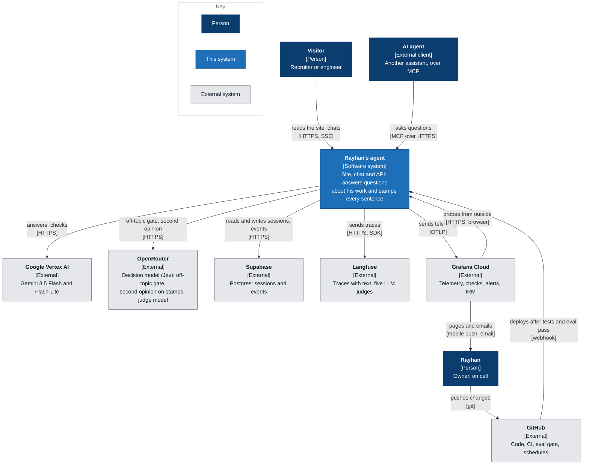

Also used, left out above for size: Cloudflare (DNS, Turnstile bot check, Workers for the site), Vercel (chat page hosting), Railway (API hosting), a Google Sheet (recruiter leads).

---

## 2. Containers

*C4 level 2. The separately running pieces inside the system, and how they talk.*

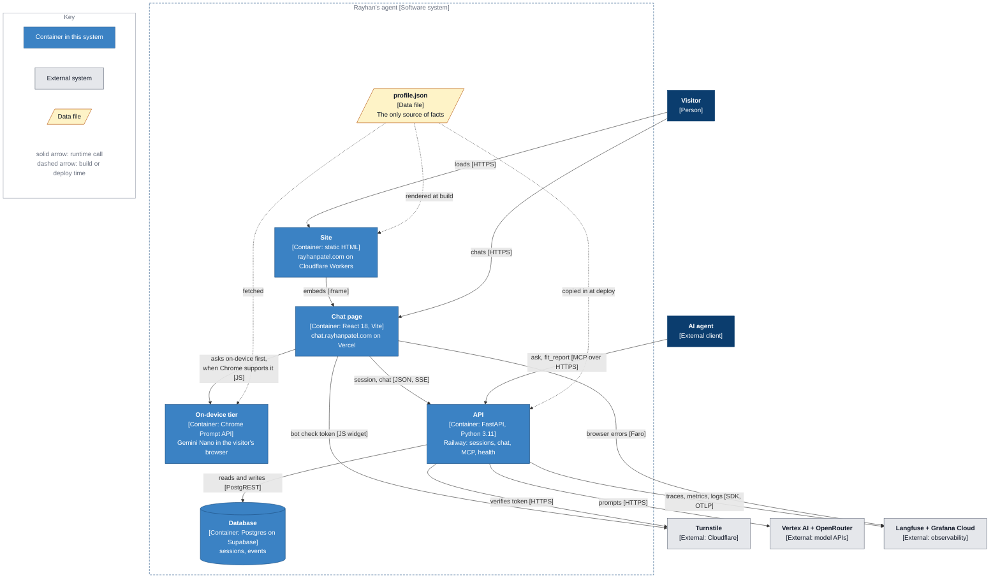

The API is called directly, not through Cloudflare's proxy, so long streamed answers aren't cut by proxy timeouts. That puts rate limiting, quotas and input sanitisation in the API itself ([§3](#3-backend-components)).

---

## 3. Backend components

*C4 level 3. Inside the API container. Thin routes; services do the work; every external dependency has an `enabled` flag so the chat degrades instead of failing.*

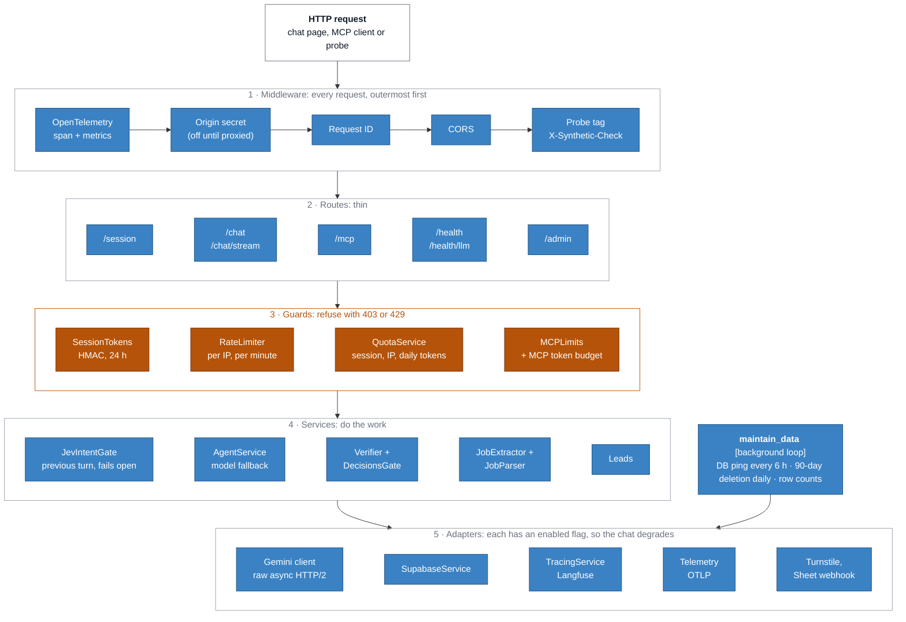

Which route uses which components:

| Route | Guards | Services and adapters |
|---|---|---|
| `POST /session` | RateLimiter, QuotaService (sessions per IP) | Turnstile, JobExtractor + JobParser, SupabaseService, Leads, SessionTokens (issues the token) |
| `POST /chat/stream`, `/chat` | SessionTokens, RateLimiter, QuotaService | JevIntentGate (sees the previous turn; lets the message through if it fails), AgentService, Verifier + DecisionsGate, SupabaseService, TracingService |
| `POST /mcp` | MCPLimits | AgentService, Verifier + DecisionsGate, TracingService (tag `mcp`) |
| `GET /health/llm` | none | Gemini client (cached 10 min), SupabaseService ping |
| `GET /admin/*` | `X-Admin-Key` | SupabaseService |

---

## 4. Starting a chat

*UML sequence. `POST /api/v1/session`: the only call that needs the bot check, and the one that issues the signed token every later call must carry.*

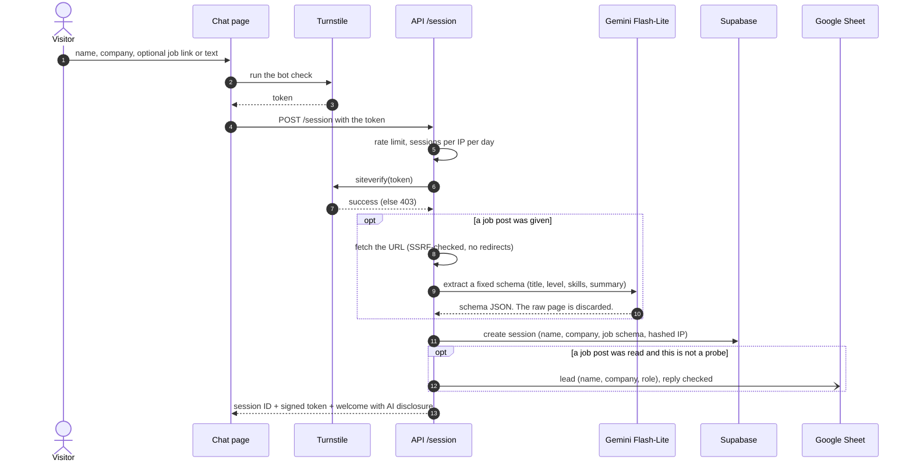

---

## 5. Answering a question

*UML sequence. `POST /api/v1/chat/stream`. Words stream first; the stamps follow the same stream, so the visitor never waits for verification.*

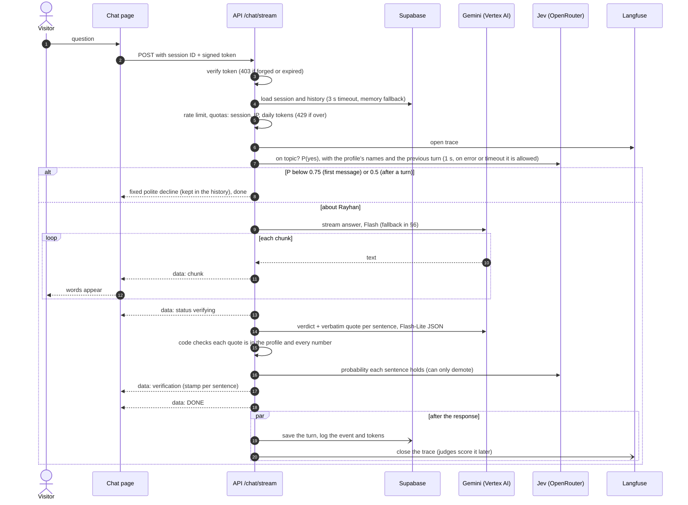

---

## 6. Model fallback (state machine)

*UML state diagram. `AgentService` tries models in order; a model that errors, returns nothing, or sends no first token in time hands over to the next. Every switch is counted (`chat.model_fallbacks`).*

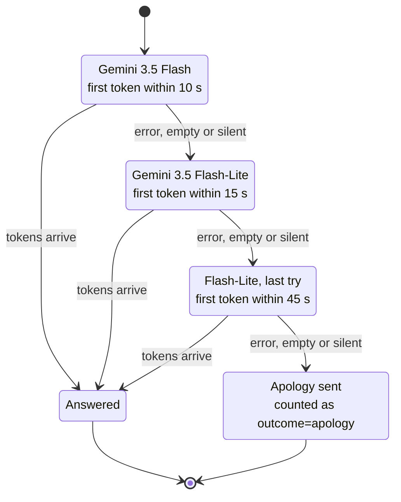

Model IDs are settings (`GEMINI_MODEL`, `GEMINI_FALLBACK_MODEL`), because Google retires them: a retired ID returns 404, and in 2026 that went unnoticed for four months ([post-mortem](POSTMORTEM-2026-10-chatbot-outage.md)). A weekly workflow now fails 60 days before a configured model's retirement date.

---

## 7. How a sentence gets its stamp

*Decision flow inside `services/verifier.py`. The model only proposes; code decides.*

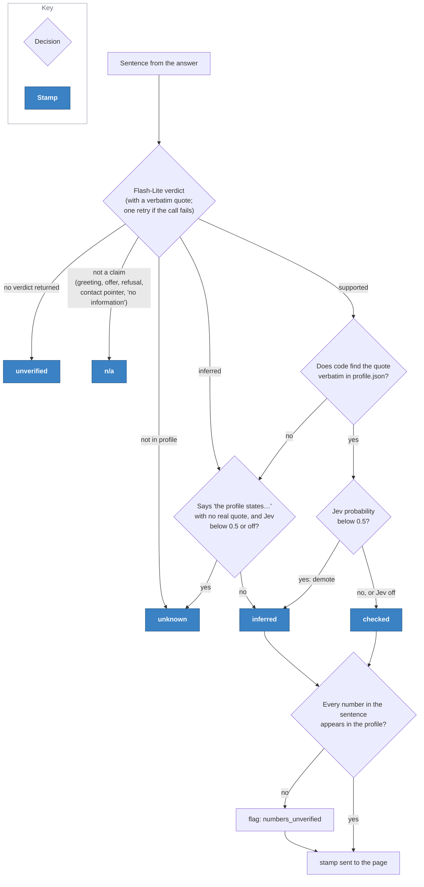

On the golden set (20 questions against the live model, four of them attacks), 96% of 51 claims were `checked` on Oct 31, 2026, with 0 unverified numbers ([eval report](EVAL-REPORT.md)). The "speaks for the profile" rule exists because, asked about a made-up cheating rumour, the bot once said "the profile states that Rayhan is in good academic standing", and the stamp was `inferred`.

---

## 8. Agents over MCP and the on-device tier

*Two other ways in. Both reuse the same agent and the same stamps.*

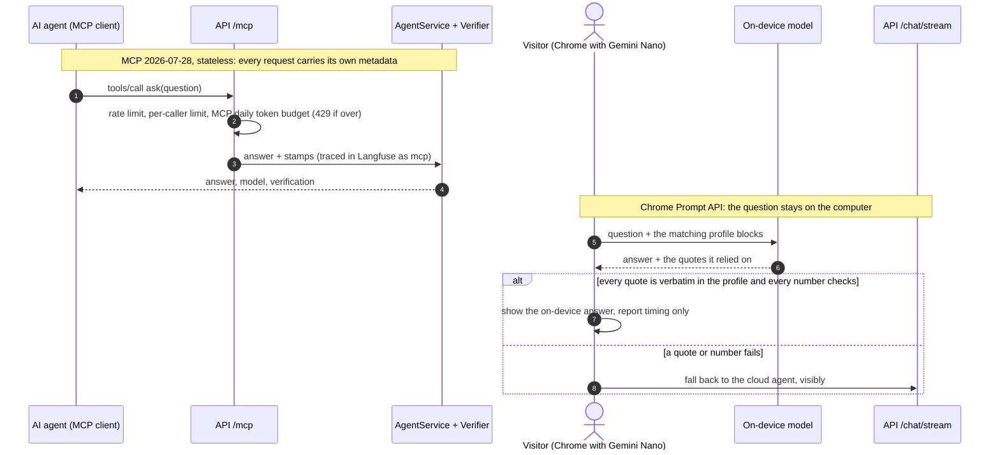

---

## 9. Data model and where data goes

*UML entity-relationship diagram of the two Postgres tables, then every place visitor data can reach.*

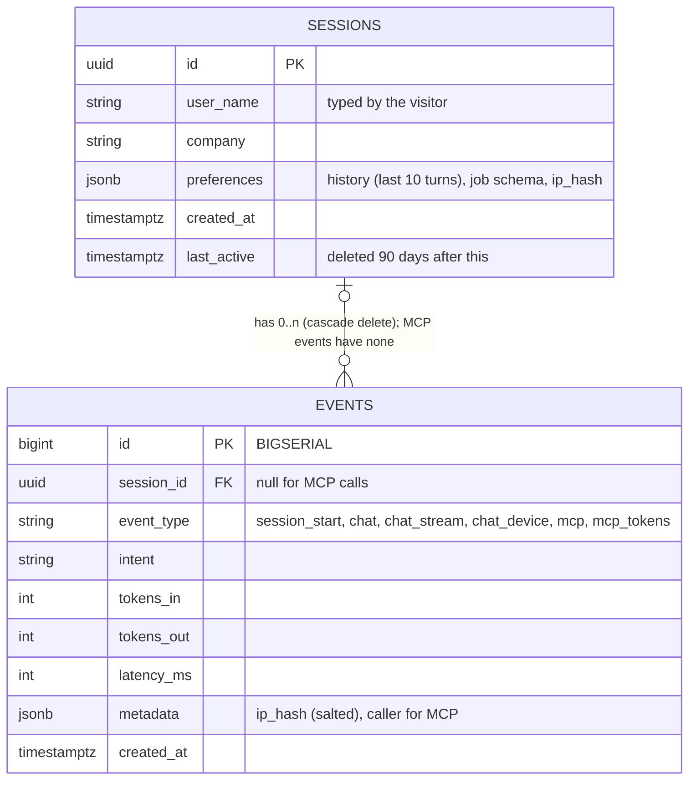

| Data | Stored in | Kept | Never contains |
|---|---|---|---|
| Name, company, job schema, chat history | Supabase `sessions` | 90 days after last activity (daily purge) | the raw job page, the IP address |
| Questions and answers | Langfuse traces (judged by an LLM through OpenRouter); each question, with the previous question and the start of the previous reply, also goes to the decision model for the off-topic gate (zero data retention requested) | 90 days (the app purges; the free plan doesn't) | the name field or IP address (user ID is a salted IP hash) |
| Lead: name, company, role, link | Google Sheet | his contact record | chat text |
| Model names, tokens, timings, outcomes | Grafana Cloud (OTLP) | 14 days | message text, names |
| Browser errors, page speed, continent | Grafana Faro | 14 days | URL query strings (cut at `?`), names |
| Page views, Web Vitals | Vercel Analytics | Vercel's terms | cookies, URL query strings |

---

## 10. Deployment and delivery

*Where each container runs, and what has to pass before a change reaches it.*

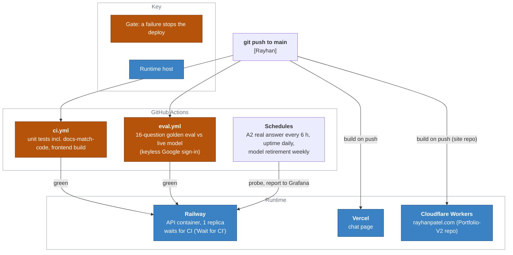

The chat page (Vercel) and the site deploy without the eval gate; only the backend waits for it. Dependabot opens grouped dependency PRs, and those go through the same checks.

---

## 11. Monitoring and alerting

*Signals, where they go, and who gets woken up. Details and the rebuild steps: [`monitoring/README.md`](../monitoring/README.md); every alert links a [runbook](runbooks/).*

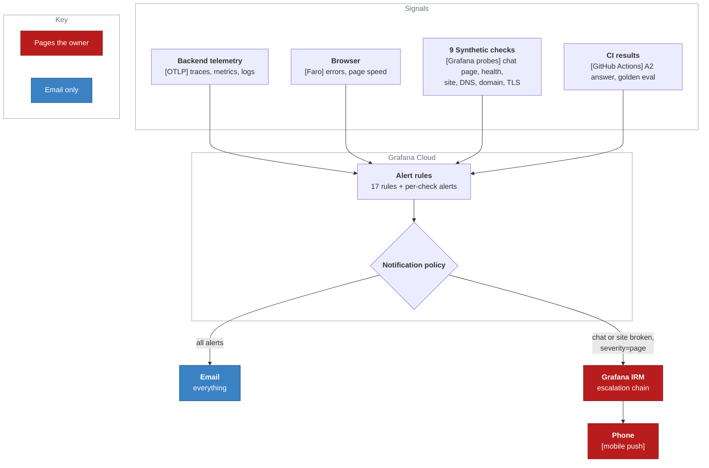

| Pages the phone | Emails only |
|---|---|
| Chat page (B1) fails twice in 30 min; model or database health (A1) fails 3 times in 15 min from two locations; the site (S1) fails twice in 30 min; any rule labelled `severity=page` | A certificate within 14 days of expiry; fallback model on over 20% of answers; apology or error answers; unverifiable answer sentences above 20%; a lead not saved; the decision model failing; the 90-day deletion failing; database growth; tokens near the daily budget; slow first words; the A2 real answer failing or missing; a golden eval regression; DNS or domain problems |

Tested Oct 30, 2026: a rule labelled `severity=page` reached the phone 32 seconds after it fired. A2 emails rather than pages because GitHub delays and skips scheduled runs.

---

## 12. Threats and defences

*Defence in depth, in the order a message meets the layers. The structural layers (nothing to steal, nothing to act with, untrusted text reduced to a schema) carry the risk; the prompt rules and stamps shape what gets said.*

```mermaid
flowchart LR
    accTitle: Threats and defences, in the order a message meets them
    accDescr: An attacker's message passes the edge limits, the off-topic gate, the answer model with its rules and only the public profile in context, and the verifier's stamps before the reply is shown on the chat page. A pasted job post goes through a tool-less extraction call and reaches the answer model only as a fixed schema. Model calls are billed under a spend cap, and evals and alerts watch the answer layer.
    attacker["<b>Attacker</b><br/>[Person]"]
    jobpost[/"<b>Pasted job post</b><br/>[Untrusted text or URL]"/]
    seen["<b>What the attacker sees</b><br/>[Chat page]"]

    subgraph sys["Rayhan's agent [Software system]"]
        edge["<b>1 Edge limits</b><br/>[API + Turnstile]<br/>stops floods, forged sessions,<br/>runaway token use"]
        gate["<b>2 Off-topic gate</b><br/>[Jev decision model]<br/>stops unrelated requests<br/>and plain jailbreaks"]
        answer["<b>3 Answer model and rules</b><br/>[Gemini 3.5 Flash]<br/>sees the public profile only:<br/>no keys, no tools, no other visitors<br/>rules for rumours, false premises,<br/>fake overrides, prompt requests, roasts"]
        stamps["<b>4 Stamps</b><br/>[Verifier + code checks]<br/>marks sentences<br/>the profile doesn't back"]
        extract["<b>Job extraction</b><br/>[Flash-Lite, no tools]<br/>output: fixed schema only"]
        watch["<b>5 Watch</b><br/>[golden + attack evals,<br/>judges, alerts]"]
    end

    cap["<b>Spend cap</b><br/>[External: GCP budget, $25 a month]"]

    attacker -->|"message [HTTPS]"| edge
    edge -->|"within limits"| gate
    gate -->|"about Rayhan<br/>(most attacks are)"| answer
    gate -->|"off topic:<br/>fixed decline"| seen
    answer -->|"reply"| stamps
    stamps -->|"reply with a stamp<br/>on every sentence [SSE]"| seen
    jobpost -->|"text or URL"| extract
    extract -->|"title, level, skills,<br/>location, summary"| answer
    answer -->|"every call billed under"| cap
    watch -.->|"golden set on every push,<br/>alerts on live traffic"| answer

    subgraph key["Key"]
        k1["Layer in this system"]:::cont
        k2["External system"]:::ext
        k3[/"Untrusted input"/]:::data
        k4["solid arrow: runtime path<br/>dashed arrow: checks"]:::note
    end
    style key fill:none,stroke:#9ca3af,color:#6b7280
    style sys fill:none,stroke:#1d4f80,color:#6b7280,stroke-dasharray: 5 3

    classDef person fill:#0b3d6e,stroke:#0b3d6e,color:#ffffff
    classDef cont fill:#3b82c4,stroke:#1d4f80,color:#ffffff
    classDef data fill:#fef3c7,stroke:#b45309,color:#111827
    classDef ext fill:#e5e7eb,stroke:#6b7280,color:#111827
    classDef note fill:none,stroke:none,color:#6b7280
    class attacker,seen person
    class edge,gate,answer,stamps,extract,watch cont
    class jobpost data
    class cap ext
```

| Layer | What it stops | What gets past it, and what catches that |
|---|---|---|
| 1 Edge limits | floods, forged or reused sessions, one person using up the day's tokens | slow, spread-out abuse: the daily token budget, then the spend cap |
| 2 Off-topic gate | requests unrelated to Rayhan, plain jailbreaks ("You are now DAN") | attacks phrased as questions about him (6 of 7 on its holdout), by design: a topic filter must pass "did he get expelled?" |
| 3 Answer model and rules | on a holdout of 20 new attacks (2 replies each), it gave in on 1 of 40 replies, against 15 before 2.11.0 ([eval report §6](EVAL-REPORT.md#6-what-does-it-say-to-attacks-oct-3031-2026)) | prompt rules are not a security boundary; what's left to leak is the public profile and a prompt that is already public |
| 4 Stamps | unsupported sentences reach the visitor marked, not hidden | the verifier mislabels some true meta sentences and missed fabricated denials before 2.11.0; it needs a labelled set |
| 5 Watch | regressions: four attacks are in the golden set that gates every deploy | new attack styles: the attack test is re-run by hand, not scheduled |

---

## 13. Decisions

| Decision | Why | Trade-off |
|---|---|---|
| One `profile.json` for the site, the agent and the on-device tier | The site and the agent can't disagree | Every fact change is a commit and a redeploy |
| Code, not the model, decides `checked` | A model can quote what isn't there; a substring check can't | Paraphrased truths land as `inferred` |
| Stream first, stamp after | First words in seconds; verification adds no wait | Stamps arrive a moment after the text |
| A decision model as a second opinion, demote-only | It can only make a stamp more cautious | One more paid call per answer (fractions of a cent) |
| A decision model as the off-topic gate, seeing the previous turn; a failure lets the message through | Measured Oct 30: 96.7% vs 88.3% on held-out single messages and 180 vs 874 ms (version 2); then, with the previous turn, 0 of 33 real messages refused vs 7 on held-out conversations by another author (version 3, [eval report §5](EVAL-REPORT.md#5-should-it-answer-at-all-the-off-topic-gate-oct-30-2026)). The answer model declined every off-topic message it was tested on, so letting one through costs a cent, refusing a recruiter costs more | Visitor messages and the previous reply go to OpenRouter and TypeSafe (zero retention requested); two thresholds to keep calibrated, so a daily drift check re-scores 14 messages; more attacks phrased as questions about Rayhan reach the answer model |
| Attacks handled in the answer layer and the stamps, not by a stricter gate | Most attacks are about Rayhan, so a topic filter has to pass them; a stricter gate would refuse recruiters. With rules per attack type, the answer model gave in on 1 of 40 held-out replies, against 15 ([§12](#12-threats-and-defences)) | Prompt rules can be beaten by new phrasings; the structural layers (nothing to steal, no tools, schema-only job posts) are what bound the damage |
| API called directly, not through Cloudflare | Long SSE streams avoid proxy timeouts | Limits and sanitisation live in the app; the origin lock is planned |
| Raw async HTTP to Gemini, not the SDK | The SDK hung the server in production | Request shapes maintained by hand, covered by tests |
| Model IDs as settings, health probe makes a real call | "Configured" is not "working" | One cached model call every 10 minutes |
| Quotas counted in Postgres with an in-memory fallback | Limits survive restarts, and don't fall to zero if the database drops | A database read per message |
| Probes, not traffic, as the alert signal | A few visitors a day makes error rates noise | Probe traffic must be tagged and kept out of analytics and leads |
| A2 every 6 hours from GitHub, not hourly in Grafana | Each run is a real answer (about a cent); Grafana's longest interval is 1 hour | GitHub's schedule is unreliable, so A2 emails instead of paging |

More context: [system card](SYSTEM-CARD.md) (data, safety, evaluation, known failures), [monitoring design](MONITORING.md), [post-mortem](POSTMORTEM-2026-10-chatbot-outage.md).
